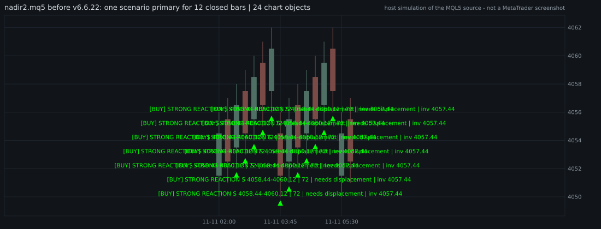
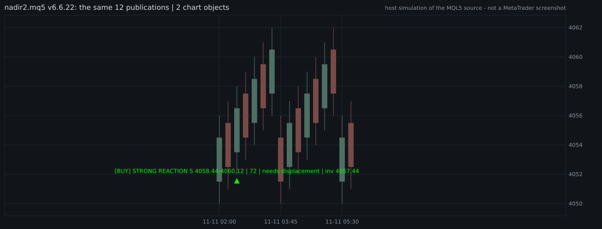
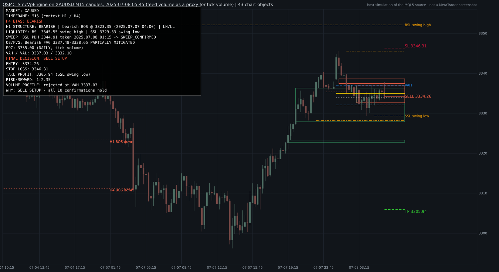

# Quantum Autonomous Trading System (QATS)

One standalone, self-contained **MQL5 Expert Advisor** for MetaTrader 5 that
analyses the chart symbol top-down (Smart Money Concepts), scores the confluence
and can execute market orders with server-side SL/TP on DEMO, or on an
explicitly authorized REAL account. REAL support is unverified in MT5.

```
MQL5/Experts/QuantumAutonomousTradingSystem.mq5   <- the ONLY deployment file
```

No external custom indicators, separate includes or DLLs. The only dependency is
MT5's standard `Trade/Trade.mqh`. The single optional preset is
`presets/Quantum_XAUUSD_PRODUCTION.set`; it is configured for DEMO, not a
claim of production readiness.

> **Status, v1.20 (2026-11-11): not production-ready.** The EA has not been compiled in
> MetaEditor, run in the MT5 Strategy Tester or forward-tested on DEMO in this work, and an
> offline replay of the real source on 9.6 years of XAUUSD data shows **negative expectancy**
> in-sample. What v1.20 fixes is engineering: v1.11 evaluated one direction per bar and could
> buy for hours without ever scoring a sell. Read
> [`docs/QATS_DUAL_DIRECTION_AUDIT_2026-11-11.md`](docs/QATS_DUAL_DIRECTION_AUDIT_2026-11-11.md)
> (Arabic: [`docs/QATS_DUAL_DIRECTION_AR.md`](docs/QATS_DUAL_DIRECTION_AR.md)) before attaching it.

## What it does

```
D1 bias -> H4 context -> H1 structure (BOS / CHoCH) -> liquidity map -> liquidity sweep
-> displacement -> order block / fair value gap -> premium/discount -> VWAP
-> M15 confirmation -> M5 entry trigger          ... for BUY and for SELL, every closed M5 bar
-> core confirmation gate -> confluence score -> direction policy -> risk guards
-> CTrade market execution -> position management (break-even, partial bank)
```

- **Market data / MTF engine** — closed candles only; D1/H4/H1/M15/M5 analysis,
  session VWAP (anchored to server day), ATR(14), EMA 20/50 (D1/H4/H1/M15).
- **SMC engine** — swing/fractal structure, BOS/MSS, liquidity pools (prior
  day/week high/low, equal highs/lows), sweep detection, displacement, order
  blocks, fair value gaps, premium/discount dealing range.
- **Dual-direction engine (v1.20)** — one function builds the evidence for BUY
  and for SELL on every closed M5 bar; neither side is a default. A setup must
  first pass the **core confirmation** of `InpStrategyProfile`
  (0 CONSERVATIVE: sweep + displacement + BOS/CHoCH + M15 or M5 ·
  1 BALANCED, the default: displacement + BOS/CHoCH · 2 ACTIVE: any two of the
  three). A liquidity sweep alone never opens a trade. When both sides qualify,
  a fixed priority list decides (score lead, H1 structure, D1, H4) or the EA
  stands aside; it never holds both sides, and a setup that produced a position
  cannot produce a second one.
- **Scoring** — 0–100 weighted confluence, one table for both sides, weights
  summing to exactly 100; trades only at or above `InpMinScore` (default 55).
  On XAUUSD (including broker suffixes), EMA/counter-D1 vetoes and execution
  profiles are diagnostic only; the normal risk and execution guards still
  apply. Other symbols retain their configured directional and profile gates.
- **Journal** — every signal has a traceable life cycle:
  `[QATS][BUY|SELL][DETECTED]`, `[QATS][SIGNAL][SCORED]` (both scores and the
  evidence behind each point, every bar), `[QATS][SIGNAL][CONFLICT]`,
  `[QATS][BLOCK][REASON]` (all active guards), `[QATS][EXECUTION][APPROVED|REJECTED|FILLED]`,
  `[QATS][COOLDOWN]`, `[QATS][STATS]`. `tools/qats_journal_report.py` turns a
  terminal log into a BUY-vs-SELL report.
- **Risk** — equity-based position sizing (never a fixed balance), hard-capped
  at 2% per trade; daily loss lock (persisted), account drawdown halt from
  equity high-water mark (a latch: it needs an operator reset), consecutive-loss
  stand-down with an explicit, persisted cooldown state (losses are counted per
  position, net of commission and swap, from the deal history), daily trade
  cap, max positions, spread and slippage filters, broker stop/freeze level
  validation, margin validation with automatic volume shrink-to-fit. The
  daily-loss and drawdown guards read ACCOUNT equity: other positions on the
  same account move them.
- **Execution** — `CTrade` market orders, server-side SL/TP, retcode
  classification (XAUUSD submissions are never automatically retried, to avoid
  duplicates after ambiguous outcomes), post-order
  **position verification** (a retcode is not proof of a fill), duplicate-order
  prevention, persisted guard state across reloads. An XAUUSD submission is
  reserved per account, magic, symbol, direction and M5 analysis bar, and is
  not retried even after a rejection or restart. The target is the nearest
  intact opposing liquidity that pays at least `InpMinRR`, else `InpRewardRisk`
  times the stop.
- **Protection** — DEMO is allowed by default. REAL requires `InpDemoOnly=false`,
  `InpAllowRealTrading=true`, and exact account login and server confirmations.
  CONTEST and unknown modes are refused; account identity, mode and terminal,
  EA, account and symbol permissions are rechecked. A changed account requires
  a fresh attachment. The same risk and broker checks apply to both modes.

## Build (MetaEditor — required)

MetaEditor ships with MetaTrader 5 (Windows). Compilation cannot be done on a
headless Linux CI box.

1. Copy `MQL5/Experts/QuantumAutonomousTradingSystem.mq5` to
   `<TerminalDataFolder>\MQL5\Experts\`
   (in MT5: **File → Open Data Folder**, then `MQL5\Experts`).
2. Open it in MetaEditor (F4), press **F7**.
   Required: **0 errors, 0 warnings**. Output:
   `QuantumAutonomousTradingSystem.ex5` next to the source. **This has not been
   done for v1.20**; if MetaEditor reports anything, copy the Errors tab verbatim.
3. Offline checks (need Python 3 and, for the last two, `g++`):

   ```
   python3 tools/verify_quantum_ea.py            # structural verifier; not a compiler
   python3 tools/test_qats_native_build.py       # whole file, strict host C++ build against a typed MQL5 shim
   python3 tools/test_qats_dual_direction.py     # the real source in a broker simulator; BUY/SELL mirror proof
   ```

   A clean host build is evidence, not proof, of a clean F7.

## Attach & verify (MT5, DEMO only)

1. Log into a **DEMO** account. Enable **Algo Trading** in the toolbar.
2. Drag `QuantumAutonomousTradingSystem` onto a chart (any symbol; the full
   multi-timeframe analysis runs internally regardless of chart timeframe).
3. Load `presets/Quantum_XAUUSD_PRODUCTION.set` in the EA Inputs dialog.
   This arms order submission on DEMO. The risk in this preset is 0.10% per trade;
   the compiled defaults without the preset differ.
4. Read the attach banner in the Experts journal:
   - `[QATS] QuantumAutonomousTradingSystem v1.20 attaching to ...`
   - `[QATS][POLICY] direction: BUY and SELL are scored independently ...
     profile=BALANCED ...` — the strategy profile in force.
   - `[QATS][PROTECTION] PASS: DEMO account authorized ...` —
     anything else means **the EA will not trade**.
   - `[QATS][RISK] per-trade risk = ...` — the effective risk after caps.
   - `[QATS][COOLDOWN] state=IDLE at attach ...` — or the stand-down it resumed.
   - `[QATS] data pipeline OK | ATR(H1)=... VWAP=...` — market data flowing.
5. `InpHeartbeatSeconds=300` prints a status heartbeat every 5 minutes
   (equity, day P/L, drawdown, guards, spread, last BUY and SELL score).
6. After a session: Experts tab → right-click → Open → `MQL5\Logs\YYYYMMDD.log`,
   then `python3 tools/qats_journal_report.py <log>`. The acceptance criteria of
   the DEMO test are in section 7.3 of the audit.

## Operating modes

| Deliberate setting | Behaviour |
|---|---|
| `InpEnableTrading=false` | never sends an order (analysis only) |
| `InpDryRun=true` | logs the exact order it would send; sends nothing |
| `InpDemoOnly=false` | Does not authorize REAL alone; all three REAL settings below are also required |
| `InpResetBreakersAtInit=true` | one-shot operator reset of persisted guards at attach, then set back to `false` |
| `InpStrategyProfile=0 / 1 / 2` | CONSERVATIVE / BALANCED (default) / ACTIVE core confirmation |
| `InpVerbose=false` | one `[QATS][SIGNAL][SCORED]` line per change of outcome instead of one per bar |

Defaults ship **armed on DEMO** (`InpEnableTrading=true`, `InpDryRun=false`,
`InpDemoOnly=true`). One chart per symbol per magic number. Management orders
are also blocked when the master switch is off, in dry run, or when account
authorization fails; an existing position then requires manual monitoring.

### REAL authorization — manual, after testing

Compile with MetaEditor, complete Strategy Tester and DEMO verification first.
For the intended REAL account, deliberately set `InpDemoOnly=false`,
`InpAllowRealTrading=true`, `InpRealAccountConfirm` to its exact numeric login,
and `InpRealServerConfirm` to its exact broker server in MT5 Inputs. The shipped
preset keeps authorization off and both confirmations empty. Do not put account
identities into a shared preset. Check the Experts journal and risk settings;
the account and server are checked again before entry. v1.20 has not been
compiled or execution-tested in MT5, its strategy shows no positive expectancy
in simulation, and it is not production-ready.

## Backtest study (simulation)

`tools/qats_backtest.py` replays the real EA source, built by the host compiler,
on M1 bid/ask history: `fetch` (a pinned public dataset, not redistributed
here), `study` (in-sample / out-of-sample, v1.11 against v1.20, per direction),
`mirror` (the direction-symmetry proof), `report`. Results and their limits:
[`docs/QATS_BACKTEST_STUDY_2026-11-11.md`](docs/QATS_BACKTEST_STUDY_2026-11-11.md).
It is not the MT5 Strategy Tester.

> **Erratum (file seams).** The yearly files of the public dataset overlap at their seams (8,127
> one-minute rows, 0.23%, appear in two files). The study figures were produced by a loader that
> fed those rows twice. The loader now skips a row that does not move time forward
> (`tools/test_qats_dual_direction.py` 4b pins it); the study has **not been re-run yet**, so its
> exact figures predate the fix. See the note at the top of the study document.

## QSMC indicator: a clean chart, and an SMC + Volume Profile decision engine (v6.6.22)

The repository also carries the QSMC indicator `nadir2.mq5` and its `MQL5/Include/QSMC`
layer. Two display-side changes, neither of which can place an order:

* **`nadir2.mq5` - one mark per setup.** A scenario that stayed primary for N closed bars
  used to leave N arrows and N copies of the same label on the chart. The mark now belongs to
  the setup, not to the bar it was re-published on, and a layer policy (`InpChartProfile=CLEAN`)
  hides the optional and detail object families by default.
* **`MQL5/Indicators/QSMC_SmcVpEngine.mq5` - a new, separate indicator.** Ten confirmations in a
  fixed order (H4 bias, H1 structure, M15 liquidity, sweep, displacement, BOS/CHoCH, OB/FVG,
  volume profile, entry, risk/reward), no scoring: `BUY SETUP` or `SELL SETUP` only when every
  step of exactly one side holds on closed bars, otherwise `WAIT` with the step that blocks.
  A 16-row dashboard, about 40-50 chart objects, entry / stop / target with a minimum
  reward-to-risk, a volume profile labelled as what it is (broker tick volume).





The pictures are drawn from the object list a host-compiled run of the real MQL5 text left on
a simulated chart (`tools/smcvp_make_pictures.py`); they are not MetaTrader screenshots.

> **Status: not compiled in MetaEditor, not run in the Strategy Tester, not seen on a live
> chart.** None of that can run where this was written. What was verified, how, and what was
> not: [`docs/QSMC_SMCVP_ENGINE_AUDIT_2026-11-11.md`](docs/QSMC_SMCVP_ENGINE_AUDIT_2026-11-11.md)
> (Arabic operator guide: [`docs/QSMC_SMCVP_ENGINE_AR.md`](docs/QSMC_SMCVP_ENGINE_AR.md)).
> The engine describes conditions; nothing here shows that trading its setups is profitable.

```
python3 tools/test_qsmc_chart_hygiene.py     # nadir2: the real draw function, before / after
python3 tools/test_qsmc_smcvp.py             # the engine: units, mirrored replay, sanitizers
python3 tools/check_production_ready.py      # the whole offline gate (57 checks)
```

## Repository layout

```
MQL5/Experts/QuantumAutonomousTradingSystem.mq5   the EA (v1.20)
presets/Quantum_XAUUSD_PRODUCTION.set               the only deployment preset
tools/verify_quantum_ea.py                        offline structural verifier
tools/qats_native.py                              .mq5 -> C++ rewrite, strict build, MQL5 lint
tools/qats_sim/                                   typed MQL5 shim, broker simulator, scenarios
tools/qats_backtest.py                            fetch / run / study / mirror / report
tools/qats_journal_report.py                      BUY-vs-SELL report from an MT5 journal
tools/test_qats_*.py                              the three v1.20 suites
docs/QATS_DUAL_DIRECTION_AUDIT_2026-11-11.md      v1.20 audit, evidence, verdict
docs/QATS_DUAL_DIRECTION_AR.md                    the same for the operator, in Arabic
docs/QATS_BACKTEST_STUDY_2026-11-11.md            simulation study, full tables
docs/incident-20261101/                           preserved incident audit record
docs/PRODUCTION_AUDIT_2026-11-09_QUANTUM_EA.md    consolidation audit (v1.00)
.github/workflows/quantum-verify.yml              CI: structural checks + host build + simulator

nadir2.mq5, MQL5/Indicators/nadir2.mq5            the QSMC indicator (v6.6.22), two identical copies
MQL5/Indicators/QSMC_SmcVpEngine.mq5              SMC + Volume Profile decision engine (display only)
MQL5/Include/QSMC/QSMC_Svp*.mqh                   its modules: core, liquidity, zones, volume profile, decision, chart
MQL5/Include/QSMC/QSMC_SignalRegistry.mqh         one identity and one lifecycle per setup (both indicators)
MQL5/Include/QSMC/QSMC_ChartLayers.mqh            nadir2's layer policy (CLEAN / LEGACY)
tools/smcvp_native.py, tools/smcvp_sim/           host build of the indicators + chart-object simulator + drivers
tools/test_qsmc_chart_hygiene.py                  nadir2 chart-hygiene suite
tools/test_qsmc_smcvp.py                          engine suite
tools/smcvp_chart_svg.py, smcvp_make_pictures.py  the simulated chart as SVG (docs/img/)
docs/QSMC_SMCVP_ENGINE_AUDIT_2026-11-11.md        audit, verification, limits
docs/QSMC_SMCVP_ENGINE_AR.md                      operator guide, in Arabic
docs/QSMC_BUILD_AND_RUN.md                        build / run / verify for the QSMC layer
```

Historical recovery point before the consolidation cleanup:
`439420d588d5ac3bbe64bf7ca2260e230abd2d95` (current `main` tip; branch
`arena/f83fc236-terad` is based on it). `git log` retains the full pre-cleanup
history.
