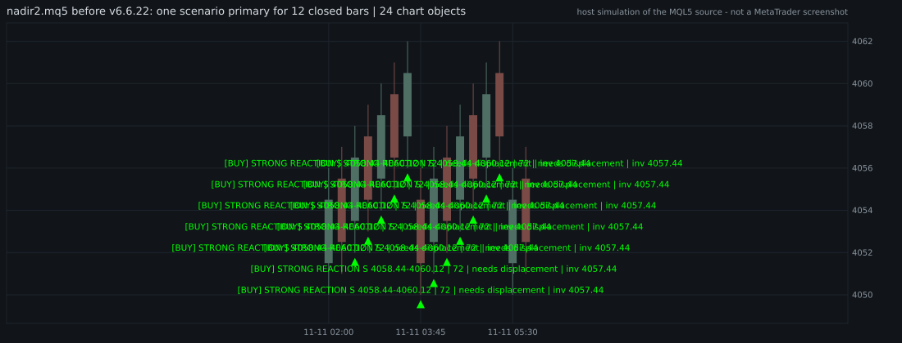
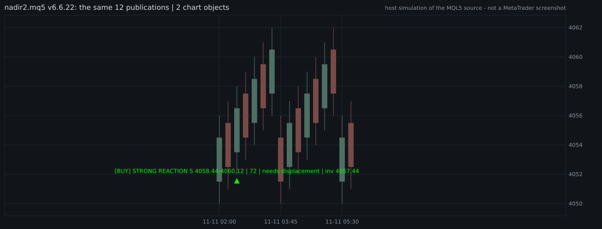
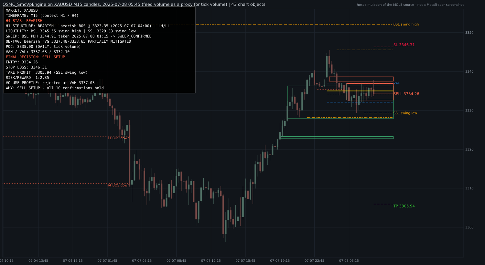

# QSMC v6.6.22 — دليل المشغّل: مخطط نظيف + محرّك قرار SMC + Volume Profile

التاريخ: 2026-11-11 — التقرير الفني الكامل (بالإنجليزية):
[`QSMC_SMCVP_ENGINE_AUDIT_2026-11-11.md`](QSMC_SMCVP_ENGINE_AUDIT_2026-11-11.md)

---

## 0. الخلاصة بصراحة

| السؤال | الجواب |
|---|---|
| هل ما زال `nadir2.mq5` يكرّر نفس العلامة على كل شمعة؟ | لا. سيناريو واحد ظلّ primary لمدة 12 شمعة كان يترك 24 كائناً، والآن يترك 2 فقط. |
| هل يوجد قرار واحد واضح (BUY SETUP / SELL SETUP / WAIT)؟ | نعم، في مؤشر جديد مستقل: `QSMC_SmcVpEngine.mq5`. |
| هل البيع والشراء متماثلان؟ | نعم. سنتان من شموع XAUUSD M15 الحقيقية وصورتها المعكوسة أعطتا قرارات معكوسة تماماً على كل الـ 47,371 شمعة. |
| هل يعيد الرسم (repaint) أو ينظر للمستقبل (look-ahead)؟ | لم يظهر ذلك في أي اختبار (8,610 قراراً أُعيد حسابها بعد 40 شمعة، و236 إعادة إرفاق: صفر اختلاف). |
| **هل تمّت الترجمة في MetaEditor (F7)؟** | **لا — BLOCKED.** لا يوجد MetaTrader في بيئة العمل. |
| **Strategy Tester أو مخطط حيّ؟** | **لا — BLOCKED.** |
| هل إعداداته (setups) مربحة؟ | **غير مُثبَت ولا ندّعيه.** 28 setup في سنتين: 8 وصلت الهدف أولاً، 18 وصلت الوقف أولاً، 2 لم تُحسم. هذا عدّ وليس دليلاً. |

كل ما تحقّقنا منه تمّ ببناء كود MQL5 الحقيقي بمترجم ++C على محاكٍ للمنصّة. هذا دليل قوي على
سلوك الكود لكنه **ليس بديلاً عن F7 ولا عن المخطط الحيّ**. الخطوات المطلوبة منك في القسم 7.

---

## 1. ماذا تغيّر

### 1.1 `nadir2.mq5` (المؤشر الأصلي) — علامة واحدة لكل setup

**السبب الجذري للتكرار:** الدالة `AlertDispatcherDrawPrimary()` كانت تسمّي السهم والنص باسم
الشمعة التي *نُشر* عليها السيناريو (`QSMC_PRIMARY_<وقت الشمعة>`)، وتُستدعى مرّة عند كل إغلاق
شمعة. فالسيناريو الذي يبقى primary لعدد N من الشموع يترك N سهماً و N نسخة من نفس النص.

**الإصلاح:** العلامة الآن تُسمّى باسم الشمعة التي *نشأ* عليها الـ setup (من
`QSMC_SignalRegistry.mqh`). إعادة النشر تحدّث نفس الكائنين ولا تنشئ جديداً.




**الطبقات (Layers):** كل عائلات الكائنات الـ 104 صُنّفت:

| الطبقة | العدد | الافتراضي |
|---|---|---|
| PRIMARY — بطاقة القرار، الـ setup النشط، Entry/SL/TP | 24 | ظاهرة |
| SECONDARY — BOS/CHoCH، السيولة، OB/FVG النشطة | 15 | ظاهرة |
| VOLUME — POC / VAH / VAL، HVN / LVN | 3 | ظاهرة |
| VOLUME DETAIL — histogram، صندوق value area | 6 | **مخفية** |
| OPTIONAL — المعاينات، التاريخ، الجلسات، البحث | 55 | **مخفية** |
| SYSTEM — كائن داخلي واحد | 1 | ظاهر دائماً |

ثمانية مدخلات جديدة في **آخر** نافذة الإعدادات:

| المدخل | الافتراضي | المعنى |
|---|---|---|
| `InpChartProfile` | `CLEAN` | `CLEAN` = الطبقات؛ `LEGACY` = السلوك القديم كما هو |
| `InpLayerPrimary` | true | |
| `InpLayerSecondary` | true | |
| `InpLayerVolumeProfile` | true | |
| `InpLayerVolumeDetail` | false | histogram وتفاصيل الحجم |
| `InpLayerOptional` | false | كل ما هو اختياري |
| `InpPrimaryMarkHistory` | 2 | عدد علامات primary السابقة التي تبقى |
| `InpSignalEpisodeGapBars` | 3 | شموع بلا إعادة نشر قبل اعتبار نفس المنطقة إشارة **جديدة** |

للعودة إلى المخطط القديم تماماً: `InpChartProfile = LEGACY`.

لم يُضَف ولم يُحذَف أي سطر داخل جسم الملف (نفس عدد الأسطر، سطرا include في الذيل فقط)،
ولم يتغيّر أي buffer.

### 1.2 `QSMC_SmcVpEngine.mq5` — مؤشر جديد مستقل (v1.00)

**لماذا مؤشر جديد وليس تعديل `nadir2.mq5`؟** اختبارات التدقيق مربوطة بأرقام أسطر ذلك الملف
(45,000 سطر)، وأي إدراج داخله يكسرها؛ والفصل يسمح لك بحذف أيٍّ منهما دون المساس بالآخر.
كائناته اسمها `QSVP_*` وكائنات `nadir2` اسمها `QSMC_*`، فيعملان على نفس المخطط دون تعارض.

هو مؤشر **عرض فقط**: لا يفتح صفقات، لا يقرأ الحساب، ولا يحتوي أي استدعاء تداول.

---

## 2. كيف يقرّر المحرّك

عشرة شروط بترتيب ثابت، كل شرط PASS / FAIL / PENDING / N/A. **لا يوجد scoring ولا أوزان.**
نفس الدالة تقيّم الجهتين (`SVP_EvaluateSide(+1)` و `(-1)`).

| # | الشرط | المطلوب (لصفقة شراء، والبيع معكوس) |
|---|---|---|
| 1 | H4 BIAS | بنية H4 صاعدة على شموع مغلقة |
| 2 | H1 STRUCTURE | بنية H1 الخارجية موافقة |
| 3 | M15 LIQUIDITY | خريطة السيولة موجودة (EQH/EQL، PDH/PDL، PWH/PWL، swings) |
| 4 | LIQUIDITY SWEEP | مستوى أُخذ بذيل ثم أغلقت الشمعة داخله (أو كسر فاشل) |
| 5 | DISPLACEMENT | شمعة اندفاعية بعيداً عن الـ sweep |
| 6 | BOS / CHoCH | بنية M15 تتحوّل باتجاه الصفقة ضمن المهلة |
| 7 | OB / FVG | منطقة من نفس الموجة ما زالت حيّة |
| 8 | VOLUME PROFILE | الـ profile **يدعم** منطقة الدخول. المحايد يمنع أيضاً ما دام `InpSveVpRequired=true` (الافتراضي)؛ والمعاكس يمنع دائماً |
| 9 | ENTRY | السعر عاد للمنطقة وأغلق خارجها (لا دخول على ذيل) |
| 10 | RISK/REWARD | مستوى حقيقي يعطي على الأقل `InpSveMinRR` (2.0) |

* **BUY SETUP** أو **SELL SETUP** فقط حين تتحقّق العشرة لجهة **واحدة** فقط.
* غير ذلك **WAIT**، وسطر `WHY` يسمّي الشرط الذي يمنع.
* **Stop Loss** = خلف قمّة/قاع الـ sweep أو حافة المنطقة البعيدة + 0.20 ATR + السبريد،
  مقرَّب على الـ tick بعيداً عن السعر.
* **Take Profit** = أقرب مستوى **حقيقي** (سيولة أو بنية) يحقّق الحد الأدنى. لا هدف مُختلَق.
* الخطة تُجمَّد على شمعة التأكيد ولا تتغيّر بعدها.

### دورة حياة الإشارة (إشارة واحدة لكل setup)

`DETECTED` ← `CONFIRMED` ← `ACTIVE` ← `MITIGATED` (الهدف تُداوِل) / `INVALIDATED` (الوقف
تُداوِل) / `EXPIRED` (أقدم من 96 شمعة). العمر يُحسب **بالشموع** لا بالساعات (عطلة نهاية
الأسبوع لا تُنهي الإشارة). تنبيه واحد فقط عند التأكيد، وفقط إذا `InpSveAlerts=true`
(الافتراضي false).

---

## 3. قراءة اللوحة (Dashboard) — 16 سطراً بترتيب ثابت

```
MARKET: XAUUSD
TIMEFRAME: M15 (context H1 / H4)
H4 BIAS: BEARISH
H1 STRUCTURE: BEARISH | bearish BOS @ 3323.35 (2025.07.07 04:00) | LH/LL
LIQUIDITY: BSL 3345.55 swing high | SSL 3329.33 swing low
SWEEP: BSL PDH 3344.91 taken 2025.07.08 01:15 -> SWEEP_CONFIRMED
OB/FVG: Bearish FVG 3337.48-3338.65 PARTIALLY MITIGATED
POC: 3335.00 (DAILY, tick volume)
VAH / VAL: 3337.03 / 3332.10
FINAL DECISION: SELL SETUP
ENTRY: 3334.26
STOP LOSS: 3346.31
TAKE PROFIT: 3305.94 (SSL swing low)
RISK/REWARD: 1:2.35
VOLUME PROFILE: rejected at VAH 3337.03
WHY: SELL SETUP - all 10 confirmations hold
```

* في حالة `WAIT`: أسطر STOP LOSS / TAKE PROFIT / RISK/REWARD تعرض `N/A`، وسطر ENTRY يعرض
  `N/A` أو `N/A (awaiting retest of <حدّا المنطقة>)`. لا يظهر سعر دخول أو وقف أو هدف إلا مع
  setup فعلي.
* سطر `WHY` في حالة الانتظار مثل:
  `WAIT - BUY candidate 8/10, PENDING at ENTRY: awaiting a retest of 2117.10-2121.80`
  أي: ثمانية شروط تحقّقت، والمتبقّي هو عودة السعر للمنطقة.
* `(DAILY, tick volume)` تذكير بأن الحجم هو **tick volume من الوسيط** وليس حجم بورصة مركزي
  ولا order flow.



(الصورة مرسومة من قائمة الكائنات التي تركها الكود على مخطط مُحاكى — ليست لقطة من MetaTrader.)

---

## 4. ماذا يُرسم على المخطط

| الطبقة | المحتوى | المدخل | الافتراضي |
|---|---|---|---|
| Primary | اللوحة، منطقة الدخول، خطوط Entry / SL / TP ونصوصها | `InpSveShowPrimary` | true |
| Secondary | آخر BOS/CHoCH لكل إطار، أقرب سيولة، أقرب OB/FVG | `InpSveShowSecondary` | true |
| Volume | POC، VAH، VAL، HVN/LVN مختارة | `InpSveShowVolume` | true |
| Histogram | أعمدة الحجم (حتى 40 صفاً)؛ يحتاج `InpSveShowVolume=true` أيضاً | `InpSveShowHistogram` | false |
| Optional | الإشارات المنتهية، sweeps قديمة، بنية أقدم | `InpSveShowOptional` | false |

قواعد النظافة (كلها مُختبَرة):

* صندوق واحد لكل منطقة سعرية — لا صندوقان فوق بعضهما لنفس الجهة.
* علامة واحدة لكل مستوى مكسور — كسر H4 و H1 لنفس القمّة يُكتب `H4+H1 BOS up`.
* HVN/LVN الواقع على POC/VAH/VAL لا يُرسم مرّة ثانية.
* **لا نص فوق نص** — النص الذي سيتداخل مع نص أهمّ منه يُحجَب، وخطّه يبقى (ومعه tooltip).
* **لا خط يشطب نصاً** — نصوص المستويات (Entry/SL/TP، السيولة، POC/VAH/VAL) تقع في عمود
  على **يمين آخر شمعة** حيث لا يصل أي خط.
* في العادة 40–50 كائناً على المخطط (الحد الأقصى المُقاس 52 مع اللوحة).

**مهم — Chart Shift:** نصوص المستويات تحتاج الهامش الأيمن للمخطط. إذا كان Chart Shift
مطفأً فالمؤشر يشغّله مرّة واحدة ويكتب ذلك في Journal. إن لم ترد ذلك:
`InpSveChartShift=false` (عندها النصوص خارج النافذة والخطوط واللوحة كاملة).

---

## 5. أهم المدخلات

| المدخل | الافتراضي | متى تغيّره |
|---|---|---|
| `InpSveMinRR` | 2.00 | الحد الأدنى للعائد/المخاطرة إلى مستوى حقيقي |
| `InpSveVpRequired` | true | true = يجب أن يدعم الـ profile منطقة الدخول (المحايد أو غياب الـ profile يمنع). false = المحايد وغياب الـ profile لا يمنعان. المعاكس يمنع في الحالتين |
| `InpSveProfileKind` | DAILY | session / daily / weekly / visible range |
| `InpSveUseRealVolume` | false | true فقط إذا كان وسيطك يعطي real volume على **كل** شمعة |
| `InpSveSlBufferATR` | 0.20 | هامش الوقف خلف البنية |
| `InpSveAlerts` | false | تنبيه واحد عند تأكيد setup |
| `InpSveLog` | true | سطر واحد في Journal عند كل **تغيّر** في القرار |
| `InpSveCorner` / `InpSveFontSize` | 0 / 9 | مكان اللوحة وحجم الخط |
| `InpSveChartShift` | true | انظر القسم 4 |

القيم غير المنطقية (سالبة، خط 500، زاوية 9 …) تُقيَّد تلقائياً إلى قيم آمنة.

### للقراءة من EA (اختياري)

خمسة buffers من نوع `DRAW_NONE` تُكتب على الشموع **المغلقة** فقط:

| Buffer | المحتوى |
|---|---|
| 0 | القرار: `+1` BUY SETUP، `-1` SELL SETUP، `0` WAIT |
| 1 | Entry |
| 2 | Stop Loss |
| 3 | Take Profit |
| 4 | Risk:Reward |

الشموع قبل إرفاق المؤشر تبقى فارغة: الـ buffers بثّ حيّ وليست تاريخاً معاد التعبئة.
**لا يوجد EA مربوط بهذا المؤشر في المستودع**، وربطه بتنفيذ آلي قرار يحتاج اختباراً مستقلاً.

---

## 6. ما تمّ التحقّق منه (بدون MetaTrader)

```
python3 tools/test_qsmc_chart_hygiene.py     54 passed, 0 failed
python3 tools/test_qsmc_smcvp.py             79 passed, 0 failed
python3 tools/check_production_ready.py      OFFLINE GO: 57/57
```

* **199 اختبار وحدة** للمحرّك في عشر مجموعات (البنية، السيولة، الـ sweep، المناطق، الحجم،
  القرار، الإشارة، المخطط، اللوحة، المؤشر نفسه).
* **التماثل:** القصة الاصطناعية تعطي BUY SETUP (2122.60 / 2116.84 / 2135.20، RR 1:2.19)
  وصورتها المعكوسة تعطي SELL SETUP (2177.40 / 2183.16 / 2164.80).
* **بناء صارم** (كل التحذيرات أخطاء)، وبناء بمصفوفات «مسمومة»، وبناء تحت ASan + UBSan
  (مع كشف القسمة على صفر، لأن MetaTrader يوقف البرنامج عندها) — على الوحدات، وعلى المؤشر
  نفسه شمعةً بشمعة، وعلى شهرين من الشموع الحقيقية.
* **الـ stack:** المؤشر في MetaTrader له stack ثابت 1 MB. لا توجد دالة تستدعي نفسها، وأعمق
  سلسلة استدعاء تحتاج حوالي 16 KB (تقدير من التصريحات).
* **شموع حقيقية — XAUUSD M15، من 2024-01-02 إلى 2025-12-31:**

| | |
|---|---|
| شموع حُلّلت | 47,371 |
| setups | **28: 14 شراء، 14 بيع** |
| الهدف أولاً / الوقف أولاً / لم تُحسم | 8 / 18 / 2 |
| المجموع بالـ RR المخطَّط، قبل أي تكلفة | حوالي +1.6R على 26 صفقة محسومة |
| كائنات على المخطط | 52 كحدّ أقصى، المتوسط 40 |
| تكرار / صناديق متداخلة / نصوص متداخلة / نصوص مشطوبة | 0 / 0 / 0 / 0 |
| إعادة حساب بعد 40 شمعة | 8,610 مقارنة، 0 اختلاف |
| إرفاق جديد مقابل مخطط مفتوح منذ البداية | 236 مقارنة، 0 اختلاف |
| طلبات تداول | 0 |

أين توقّف WAIT: الـ sweep (18,941 شمعة)، لا مرشّح لأي جهة (16,019)، بنية H1 (8,930)، الدخول
(2,068)، OB/FVG (738)، Volume Profile (588)، RR (37).

**كيف تقرأ هذه الأرقام:** المحرّك صارم جداً — حوالي setup واحد كل ثلاثة إلى أربعة أسابيع.
8 رابحة مقابل 18 خاسرة بهذه النسب تساوي تقريباً صفراً قبل السبريد والعمولة. 26 حدثاً لا تكفي
للتمييز بين وجود أفضلية وعدمها. الجدول يُثبت أن المحرّك يتصرّف كما وُصف، **ولا يُثبت أنه يربح**.
الحجم في هذه التجربة هو حجم مزوّد البيانات (بديل تقريبي عن tick volume عند وسيطك).

---

## 7. المطلوب منك (لا يمكن عمله إلا عندك)

1. **انسخ الملفات** إلى مجلد بيانات MT5 (`File → Open Data Folder`):
   - `MQL5/Include/QSMC/*.mqh` ← `<Data Folder>/MQL5/Include/QSMC/` (كل الملفات، وعددها 31)
   - `MQL5/Indicators/QSMC_SmcVpEngine.mq5` ← `<Data Folder>/MQL5/Indicators/`
   - `nadir2.mq5` ← `<Data Folder>/MQL5/Indicators/`
2. **الترجمة:** افتح MetaEditor (F4)، افتح `QSMC_SmcVpEngine.mq5` واضغط **F7**. ثم نفس الشيء
   لـ `nadir2.mq5`. المطلوب: `0 errors, 0 warnings`.
   **إذا ظهر أي خطأ فانسخ نصّه كما هو وأرسله** — هذا أهمّ شيء لم نستطع التحقّق منه.
3. **الإرفاق:** اسحب `QSMC_SmcVpEngine` على مخطط XAUUSD (أي إطار؛ التحليل دائماً M15+H1+H4).
   يجب أن يظهر في Journal:
   ```
   [QSVP] v1.00 self-tests PASS (signal registry, volume profile)
   [QSVP] v1.00 XAUUSD | analysis M15 + H1 + H4 on closed bars | display only, no orders | volume source: broker tick volume
   ```
   (اسم الرمز يظهر كما هو عند وسيطك. وإذا كان Chart Shift مطفأً يظهر سطر ثالث يبدأ بـ
   `[QSVP] Chart Shift was off: turned ON`.)
4. **انظر:** لوحة من 16 سطراً، النصوص على يمين آخر شمعة، لا نص فوق نص. قارن مع الصورة أعلاه.
5. **راقب عدّة جلسات:** سطر واحد في Journal عند كل تغيّر قرار. أغلب الوقت `WAIT` مع سبب.
6. **`nadir2`:** أعد إرفاق v6.6.22. يجب أن يظهر في Journal سطر يبدأ بـ
   `[QSMC_ARB] v6.6.22 arbitration layer ON` (أي رقم نسخة آخر = ملف قديم في مجلد البيانات).
   علامة primary واحدة لكل setup. جرّب `InpChartProfile=LEGACY` للمقارنة.

إلى أن تضغط F7، اعتبر المؤشرين **كوداً غير مترجَم**.

---

## 8. حدود يجب أن تعرفها

* **لا ادّعاء ربحية.** المحرّك يصف شروطاً تحقّقت على شموع مغلقة؛ ليس توقّعاً.
* **نموذج النصوص تقريبي:** حرف واحد = شمعة M15 واحدة، وسطر واحد = 0.6 ATR. عند تصغير
  المخطط كثيراً قد تتقارب النصوص. المؤشر لا يقيس البكسلات.
* **حوالي خُمس النصوص يُحجَب** عند تزاحم المستويات (الخط يبقى والـ tooltip يشرحه).
* **إشارة حيّة قد لا تُرسم** إذا كانت منطقتها تتداخل مع منطقة إشارة أهمّ من نفس الجهة؛ تبقى
  مسجَّلة وتُرسم حين تنتهي الأولى.
* **الصور ليست لقطات MetaTrader:** الخطوط والألوان ومقياس السعر تختلف في المنصّة.
* **من `nadir2.mq5` نُفِّذت فعلياً دالة العلامة الأساسية والوحدتان الجديدتان فقط**؛ باقي
  الملف (45,000 سطر) لا يمكن بناؤه خارج MetaEditor، وسياسة الطبقات مُتحقَّق منها بالتصنيف
  لا برسم المخطط القديم كاملاً.
* **Volume Profile المحرّك يختلف عمداً عن `CVolumeProfile` القديم عند التعادل التام** (يأخذ
  مركز الصفوف المتعادلة بدل أدناها) حتى لا يميل السياق لجهة. بدون تعادل: النتائج متطابقة.

---

## 9. ملاحظة عن QATS (الـ EA)

أثناء هذا العمل اكتُشف أن ملفات بيانات XAUUSD السنوية **تتداخل** عند حدودها (8,127 صفّ دقيقة،
0.23%)، وأن محمِّل البيانات كان يغذّي هذه الصفوف مرّتين. أُصلح المحمِّل وثُبّت باختبار
(`tools/test_qats_dual_direction.py` القسم 4b). **وأُعيد تشغيل دراسة QATS كاملةً بعد الإصلاح**،
فالأرقام في `docs/QATS_BACKTEST_STUDY_2026-11-11.md` هي أرقام إعادة التشغيل، والملاحظة في أعلى ذلك
الملف تبيّن ما تغيّر (بضع صفقات في كل تشغيل). الخلاصة لم تتغيّر: **لا أفضلية مُثبَتة**.
