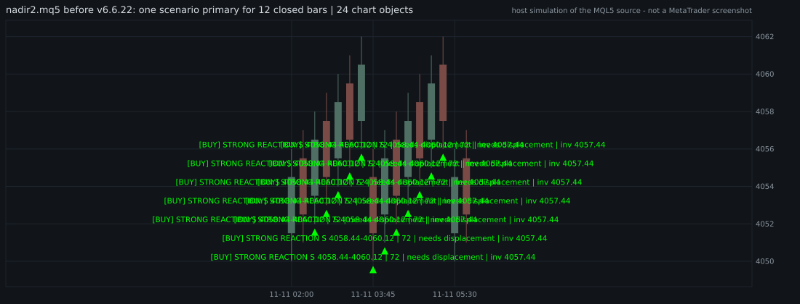
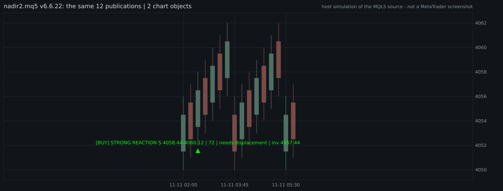
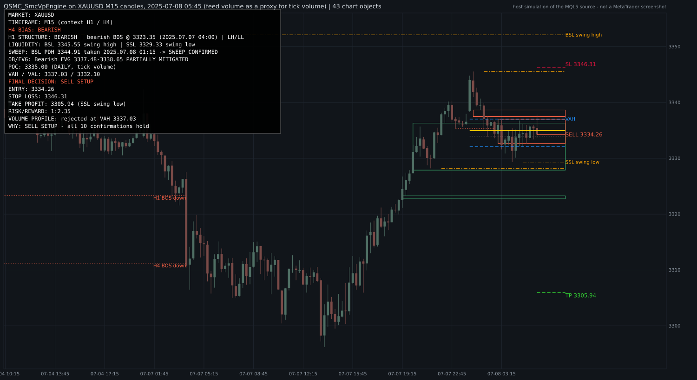
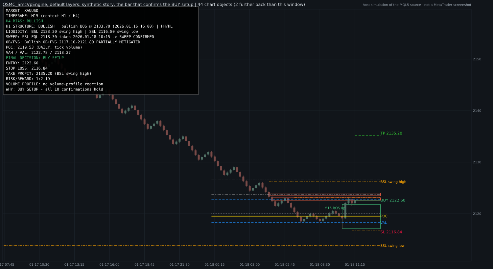
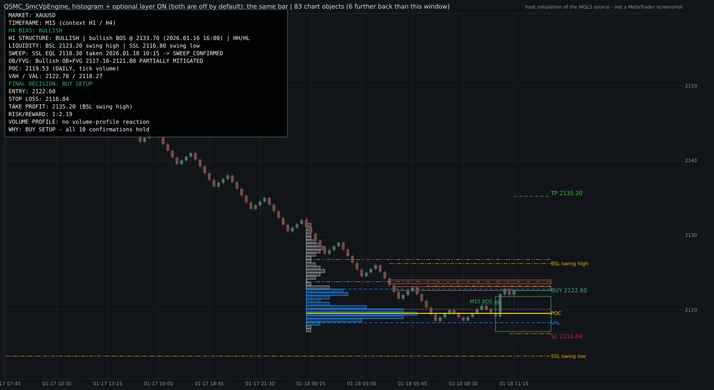

# QSMC v6.6.22 — chart hygiene and the SMC + Volume Profile decision engine

Audit, changes, verification and limits. 2026-11-11.

Operator guide in Arabic: [`QSMC_SMCVP_ENGINE_AR.md`](QSMC_SMCVP_ENGINE_AR.md).

---

## 1. Status in one table

| Question | Answer |
|---|---|
| Does `nadir2.mq5` still repeat the same label bar after bar? | No. Executed before / after on the real function: 12 publications of one scenario left 24 objects, now 2. |
| Is there one decision (BUY SETUP / SELL SETUP / WAIT) built from the ten confirmations, without scoring? | Yes, in a new indicator, `MQL5/Indicators/QSMC_SmcVpEngine.mq5`. |
| Are BUY and SELL treated symmetrically? | Yes. Two years of real XAUUSD M15 candles and their price mirror give mirrored decisions on all 47,371 bars, with the same number of chart objects on every bar. |
| Does it repaint or look ahead? | Not in any test: 8,610 decisions re-evaluated 40 bars later and 236 fresh attaches all agree with what was first shown. |
| **Compiled in MetaEditor (F7)?** | **BLOCKED — not done.** No MetaTrader exists in this environment or in CI. |
| **Strategy Tester / live chart / real broker ticks?** | **BLOCKED — not done.** |
| Is trading its setups profitable? | **Not shown, not claimed.** 28 setups in two years: 8 reached the target first, 18 the stop first, 2 neither. That is a count, not evidence. |

Everything below marked *verified* was verified by building the real MQL5 text with a host
C++ compiler against a simulator of the terminal. That is evidence, never proof, of how the
code behaves in MetaTrader. §8 lists what remains for the operator.

---

## 2. Audit of what was there

`nadir2.mq5` v6.6.21: 45,000 lines, 599 inputs, about 1,090 functions, 26 buffers, 16
`ObjectCreate` call sites, 104 object-name families under the prefix `QSMC_`.

**Why the same label was drawn again and again.** `AlertDispatcherFinalize()` runs once per
closed bar and, whenever a primary scenario exists, calls `AlertDispatcherDrawPrimary()`. That
function named its arrow and its label after the bar the scenario was *published* on
(`QSMC_PRIMARY_<bar time>`). The alert cool-down only gated the pop-up, never the drawing. A
scenario that stayed primary for N closed bars therefore left N arrows and N copies of
`[BUY] STRONG REACTION S 4058.44-4060.12 | 72 | needs ...`, bounded only by a 16-slot ring
(32 objects).

**Why the chart was crowded.** More than forty Show/Use switches default to on and
`InpDisplayMode` defaults to FULL. The display choke point `QSMC_DisplayAllowsObject()` only
knew "MINIMAL" versus "everything", and two draw primitives (`MVP_Rect`, `DrawScaleLevel`)
bypassed it.

**Volume profile.** `CVolumeProfile` (`QSMC_Stats.mqh`) is display-only: no decision reads it.

**No single decision.** Direction came from several layers (arbiter, tactical preview, ZRE,
scenario card). The arbitration layer already reconciles them for `nadir2`; nothing produced
the plain ten-step BUY / SELL / WAIT the request describes.

---

## 3. `nadir2.mq5`: one mark per setup, and layers

Changed in place, same line count (the line-pinned audit suites stay valid), two includes
appended at the tail, both copies byte-identical, CRLF kept.

* `QSMC_SignalRegistry.mqh` gives every setup (symbol, timeframe, direction, source, zone)
  one identity and one originating bar. `AlertDispatcherDrawPrimary()` names the mark after
  that bar; a re-publication updates the same two objects. A pause of
  `InpSignalEpisodeGapBars` (3) closed bars ends the episode; the opposite direction, another
  zone or another source is a new signal.
* `QSMC_ChartLayers.mqh` classifies all 104 object families — primary 24, secondary 15,
  volume 3, volume detail 6, optional 55, system 1 — and the choke point asks it first.
  `InpChartProfile=CLEAN` (default) shows primary + secondary + volume; `LEGACY` restores the
  previous behaviour exactly. `MVP_Rect` and `DrawScaleLevel` now ask the policy too.
* Eight new inputs, last in the dialog: `InpChartProfile`, `InpLayerPrimary`,
  `InpLayerSecondary`, `InpLayerVolumeProfile`, `InpLayerVolumeDetail` (off),
  `InpLayerOptional` (off), `InpPrimaryMarkHistory` (2), `InpSignalEpisodeGapBars` (3).

Verified by `tools/test_qsmc_chart_hygiene.py` (54 checks), which cuts the real function out
of `nadir2.mq5` at test time and executes it next to the same function with the eleven
pre-fix lines put back:

| Replay | Before | After |
|---|---|---|
| one scenario primary for 12 closed bars | 12 arrows + 12 labels | 1 arrow + 1 label, on the originating bar |
| 34 publications (three setups with pauses) | 32 objects (ring full) | 3 marks |
| objects created over the 12 bars | 24 | 2, none deleted |




**Limit.** Only `AlertDispatcherDrawPrimary()` and the two new modules are *executed*. The
rest of the 45,000-line indicator cannot be built for the host; the layer policy is verified
by classification (every family has a layer, 26 spot checks, the choke point's order of
tests), not by rendering the whole legacy chart. There is therefore no "before" picture of
the full FULL-mode chart, only of the repeated marks.

---

## 4. The engine: `QSMC_SmcVpEngine.mq5`

A separate, additive indicator. It was not edited into `nadir2.mq5` because inserting a line
there invalidates every line-pinned suite (`tools/pinmap.json`), and because a separate
program can be removed without touching the other. Its objects are named `QSVP_*`.

### 4.1 Decision

Ten steps, each PASS / FAIL / PENDING / N/A, evaluated by one function for both sides
(`SVP_EvaluateSide(+1)` and `(-1)`). There is no score and no weighting.

| # | Step | What must hold |
|---|---|---|
| 1 | H4 bias | H4 swing structure is bullish (for a BUY) on closed bars |
| 2 | H1 structure | H1 external structure agrees |
| 3 | M15 liquidity | resting liquidity is mapped (equal highs/lows, PDH/PDL, PWH/PWL, swings) |
| 4 | Liquidity sweep | a level was taken by a wick that closed back inside (or a failed breakout) |
| 5 | Displacement | an impulsive candle away from the sweep |
| 6 | BOS / CHoCH | M15 structure shifts in the trade direction inside the window |
| 7 | OB / FVG | an order block or fair value gap from that leg is alive |
| 8 | Volume profile | the profile supports the entry zone. Neutral also blocks while `InpSveVpRequired=true` (default); with `false` a neutral or missing profile passes. Opposing context always blocks |
| 9 | Entry | price returned to the zone and closed back out (no entry on a wick) |
| 10 | Risk / reward | a real level pays at least `InpSveMinRR` (2.0) |

`BUY SETUP` or `SELL SETUP` only when all ten hold for exactly one side; otherwise `WAIT`,
and the dashboard names the step that blocks. Stop = beyond the swept extreme / the zone's far
edge + 0.20 ATR of the confirming bar + spread, rounded to the tick away from price. Target =
the nearest real level (liquidity, structure) that pays the minimum; never an invented price.

### 4.2 One signal per setup

Identity = symbol | timeframe | direction | setup type | sweep | originating bar. Lifecycle
DETECTED → CONFIRMED → ACTIVE → MITIGATED (target traded) / INVALIDATED (stop traded) /
EXPIRED. The plan is frozen on the confirming bar. One alert per confirmation, and only with
`InpSveAlerts=true` (default false). Ages are counted in bars, never in hours.

### 4.3 Volume profile

Rows are a whole number of ticks. Labelled `BROKER TICK VOLUME` unless real volume is asked
for and present on every bar. It is context, never a signal. Tie rules are symmetric by
design: the POC is the centre of the heaviest run of equal rows, the value area grows towards
the heavier neighbour and takes equal neighbours together, a flat top is one node. On exact
ties this **differs from `CVolumeProfile`** (which takes the lowest tied row): on 120 random
profiles every row is identical, the levels are identical on the 116 without a tie, and on
the 4 with a tie the POC is up to one row above the legacy one. A lower-row rule would lean
the context towards one direction; 19.7% of real bars had such a tie.

### 4.4 Chart

Every object goes through one manager (`SVC_*`): layer caps (primary 48, secondary 40, volume
24, detail 48, optional 48; 320 in all), an identical pass performs zero chart operations,
what a pass does not draw is deleted at its end, shutdown removes only `QSVP_*`.

Layout rules, each one enforced and tested:

* one box per price area — a live signal whose zone overlaps a more important same-side zone
  stays off the chart until that one ends;
* one mark per broken level — H4 and H1 breaking the same swing are `H4+H1 BOS up`, not two
  captions on top of each other;
* a volume node that sits on the POC / VAH / VAL is not drawn a second time;
* **no caption on top of another** — a caption is withheld when its rectangle would overlap
  one already placed (its line stays, with its tooltip);
* **no caption struck through by a line** — level captions (entry / SL / TP, liquidity,
  POC / VAH / VAL) sit in one column to the right of where every line ends; captions inside
  the chart are placed last and moved to the other side of their line, or withheld, when a
  line would cross them.

The caption model is deliberately independent of the zoom (one character = one M15 bar, one
line = 0.6 ATR), so the same data always gives the same chart. About a fifth of the captions
are withheld on real data (89,578 of 456,787 over two years).





### 4.5 Host

One pass per closed M15 bar whatever the chart timeframe; between two closes nothing is
recalculated and no object is touched. 96 bars are replayed silently at start so a fresh
attach shows what a chart open all along would show. Five `DRAW_NONE` buffers on closed bars:
decision (+1 / −1 / 0), entry, stop, target, RR. No order, position or account call exists in
the program. The dashboard has 16 rows in a fixed order: MARKET, TIMEFRAME, H4 BIAS, H1
STRUCTURE, LIQUIDITY, SWEEP, OB/FVG, POC, VAH / VAL, FINAL DECISION, ENTRY, STOP LOSS, TAKE
PROFIT, RISK/REWARD, VOLUME PROFILE, WHY.

---

## 5. Verification

```
python3 tools/test_qsmc_chart_hygiene.py     54 passed, 0 failed
python3 tools/test_qsmc_smcvp.py             79 passed, 0 failed   (74 without the dataset)
python3 tools/check_production_ready.py      OFFLINE GO: 57/57     (§5.4)
```

### 5.1 `tools/test_qsmc_smcvp.py`

| Section | What | Result |
|---|---|---|
| A | source contracts: no order / account call, one `ObjectCreate` site, one `Alert` site (in the host), analysis modules read only the arrays they are given, 16 rows in order, MQL5 lint; stack estimate — no recursion, about 16 KB of locals on the deepest call chain (an indicator's stack is fixed at 1 MB) | 15 pass |
| B | strict host build (`-Wall -Wextra -Wshadow -Wconversion` as errors): normal, poisoned arrays, ASan + UBSan | 0 errors, 0 warnings |
| C | 199 units in ten groups (structure 13, liquidity 13, sweep 30, zones 14, volume 32, decision 33, signal 14, chart 18, dashboard 10, host 22), and a map from 19 requirement areas to 123 unit ids | all pass |
| D | synthetic story: BUY SETUP 2122.60 / 2116.84 / 2135.20, RR 1:2.19; its mirror: SELL SETUP 2177.40 / 2183.16 / 2164.80; mirror image on all 1,094 bars; the picture tool draws that bar as well-formed SVG and the committed picture shows the objects this build draws | pass |
| E | 7,200 bars of a synthetic series and of its mirror, through `OnInit` / `OnCalculate` / `OnDeinit` | traces and signals byte-identical; every hygiene counter 0 |
| F | the same binary with poisoned array growth | byte-identical units, story, replay |
| G | under ASan + UBSan with float-divide-by-zero (MetaTrader stops a program on a zero divide): every unit, the story, and 1,200 bars through the host | no report |
| H | 1,500+ operands of `&& \|\| !` are real `bool` | pass |
| I | a market cut into two overlapping files replays like one file | identical |
| J | real XAUUSD candles, June–July 2025 (only with the dataset present): counters, lifecycle, mirror, and the same window under the sanitizers | pass |

### 5.2 Real candles: XAUUSD M15, 2024-01-02 → 2025-12-31

`docs/qsmc_smcvp_replay_xauusd_m15_2024_2025.json` and `..._signals.csv`. Default inputs.
M1 bid candles aggregated to M15 on the New-York-close server clock. **Volume is the feed's
volume, a proxy for broker tick volume.** Outcomes are judged from the following candles
within 96 bars; a bar that trades both levels counts as the stop. No spread, commission or
slippage is applied.

| | |
|---|---|
| bars analysed through the host | 47,371 (every bar; 0 not ready) |
| setups | **28: 14 BUY, 14 SELL** (2024: 9 / 9, 2025: 5 / 5) |
| target first / stop first / neither | 8 / 18 / 2 (BUY 6 / 7 / 1, SELL 2 / 11 / 1) |
| mean planned RR | BUY 3.03, SELL 4.64 |
| sum at planned RR, before any cost | +1.6 R over 26 resolved setups |
| engine's verdict agrees with the candles | 26 of 26 |
| objects on the chart | at most 52, mean 40.3; 0.80 created per bar |
| duplicates / overlapping boxes / colliding captions / struck captions | 0 / 0 / 0 / 0 |
| dashboard | at most 18 labels, no row over 78 characters, none clipped |
| re-evaluated 40 bars later | 8,610 compared, 0 differ |
| fresh attach vs chart open all along | 236 compared, 0 differ |
| buffer mismatches, API errors, trade requests, objects left after deinit | 0, 0, 0, 0 |
| mean pass | 0.65 ms (worst 48 ms) |

Where WAIT was blocked: liquidity sweep 18,941 bars; no candidate on either side 16,019; H1
structure 8,930; entry 2,068; OB/FVG 738; volume profile 588; risk/reward 37.

**How to read it.** The engine is strict: about one setup every three to four weeks. Eight
wins against eighteen losses at these reward-to-risk ratios sums to roughly zero before
costs. Twenty-six events cannot distinguish an edge from none. This table shows that the
engine behaves as specified on real candles; it does not show that its setups make money.

**Mirror on the same two years** (prices on whole points, reflected about a line): 28 setups,
14 BUY / 14 SELL ↔ 14 / 14; the per-bar traces (decision, steps passed per side, blocking
step, object count) and the signal files are byte-identical on all 47,371 bars.

### 5.3 Mutation checks (run by hand, not part of CI)

Each of these edits was applied, the named test failed, and the source was restored
(verified by hash):

| Edit | Test that fails |
|---|---|
| draw every live signal's zone box | G13 |
| do not merge H4 / H1 breaks of one level | C16, C18 |
| draw structure captions without asking for room | C12, C16, C18 |
| draw a node that sits on a profile level | C17, C18 |
| measure caption distance in minutes instead of bars | C15 |
| do not equalise BUY/SELL, up/down caption widths | C15 |
| expire a setup by the clock instead of by bars | G14 |
| feed rows repeated at a file seam (QATS loader) | 4b of `test_qats_dual_direction.py` |

### 5.4 Repository gate

`python3 tools/check_production_ready.py --timeout 240 --require-native` on the final source:
**`OFFLINE GO: 57/57 curated checks passed`**, none skipped (55 checks that existed before +
`qsmc-chart-hygiene` + `qsmc-smcvp-engine`). `tools/check_release_gate.py`:
`GO (with 0 warning(s))`. The gate is an offline gate: its own banner says "NOT a compile,
NOT a backtest". Its closing line used to tell the operator to look for a `v6.6.20` banner
whatever the build was; it now reads the version from `nadir2.mq5`.

---

## 6. Defects found by the verification itself

Recorded because each one was in code written for this change, and each was found by a
replay or a picture rather than by a unit written in advance.

1. **Two live signals drew two boxes over the same prices.** 24 overlapping pairs in two
   months of real data. Fixed (one box per price area); G13.
2. **The volume profile leaned downward on ties** (lowest tied row as POC, value area growing
   down first). A mirrored replay showed different WAIT reasons. Reworked to symmetric rules;
   V29–V32.
3. **H4 and H1 marks printed on top of each other** when both broke the same swing: identical
   lines, identical captions. Merged into one mark; C16.
4. **Captions were struck through.** The setup tag hung where its own stop line runs, and
   liquidity captions stood where other lines pass — found by looking at the rendered chart.
   Captions moved to a column no line reaches; C12, C15, H22.
5. **An HVN on the VAL was drawn as a second line.** C17.
6. **A setup expired over the weekend.** Its age was measured in hours: confirmed on a Friday
   afternoon it was "older than 96 bars" on Monday's first bar, and the stop that traded two
   bars later was never recorded. Found because the engine's verdict disagreed with the
   candles on 1 of 24 setups. Ages are now counted in bars; G14.
7. **`Alert()` in a header.** The release gate blocks user-facing channels outside the one
   program that owns them. The module now queues the message and the host sends it; A14.
8. **The replay loader fed overlapping rows twice.** The dataset's yearly files overlap at
   their seams (8,127 rows). The duplicated bars made the engine refuse 6,978 bars of the
   two-year window ("series unusable") — the engine was right, the loader was wrong. Fixed;
   section I. **The same flaw was in the QATS back-test loader**: fixed and pinned there too,
   and the QATS study was regenerated with the fixed loader (its document lists what moved;
   no conclusion changed).

---

## 7. Limits and known weaknesses

* **The caption layout is a model, not a measurement.** One character = one M15 bar and one
  line = 0.6 ATR fit an M15 chart at the usual zoom. Zoomed far out, or on another chart
  timeframe, captions can still come close. The engine does not read pixel sizes.
* **Level captions need the chart's right margin.** They sit to the right of the newest bar.
  With Chart Shift off they are outside the window; the host turns Chart Shift on once and
  says so in the journal (`InpSveChartShift=false` leaves the chart alone). This behaviour
  runs only against the simulator so far.
* **About one caption in five is withheld** when levels crowd. The line stays; the tooltip
  says what it is.
* **Volume in every replay is a feed volume**, not the operator's broker tick volume. The
  shape of a profile on a real account can differ.
* **The pictures are not screenshots.** Fonts, anti-aliasing and the price scale differ in
  the terminal.
* **Only the primary-mark path of `nadir2.mq5` is executed** (§3).
* **The requirement map** (19 areas in section C of the suite) was rebuilt from the working
  plan of this change, not copied from the numbered lists of the original request. An item
  missing from the map is a gap in this report, not a claim that it was tested.
* **No profitability claim** (§5.2).

---

## 8. What only the operator can do

| Step | How | Expected |
|---|---|---|
| Compile | Copy `MQL5/Include/QSMC/*.mqh` and `MQL5/Indicators/QSMC_SmcVpEngine.mq5` into the data folder, open the `.mq5` in MetaEditor, press **F7**. Do the same for `nadir2.mq5`. | `0 errors, 0 warnings`. Any error text is useful: send it back. |
| Attach | Drag `QSMC_SmcVpEngine` onto an XAUUSD chart. | Journal: `[QSVP] v1.00 self-tests PASS (signal registry, volume profile)` then `[QSVP] v1.00 XAUUSD \| analysis M15 + H1 + H4 on closed bars \| display only, no orders \| volume source: broker tick volume`. |
| Look | Compare the chart with `img/smcvp_engine_xauusd_20250708.svg`. | Dashboard of 16 rows; captions to the right of the last candle; no text on top of text. |
| Watch | Leave it for a few sessions. | One journal line per decision change. Mostly `WAIT`, with the blocking step. |
| `nadir2` | Re-attach v6.6.22. | Banner `[QSMC_ARB] v6.6.22 arbitration layer ON`; one primary mark per setup; `InpChartProfile=LEGACY` brings the old chart back. |

Until F7 has been pressed, treat both indicators as **uncompiled source**.

---

## 9. Files

```
MQL5/Indicators/QSMC_SmcVpEngine.mq5         the engine's host (v1.00)
MQL5/Include/QSMC/QSMC_SvpCore.mqh           parameters, structure, ATR, tick rounding
MQL5/Include/QSMC/QSMC_SvpLiquidity.mqh      liquidity map, sweep classification
MQL5/Include/QSMC/QSMC_SvpZones.mqh          OB / FVG lifecycle
MQL5/Include/QSMC/QSMC_SvpVolumeProfile.mqh  profile, nodes, context, verdict
MQL5/Include/QSMC/QSMC_SvpDecision.mqh       the ten steps, stop, target
MQL5/Include/QSMC/QSMC_SvpChart.mqh          chart object manager, view, dashboard
MQL5/Include/QSMC/QSMC_SignalRegistry.mqh    identity and lifecycle of a signal
MQL5/Include/QSMC/QSMC_ChartLayers.mqh       nadir2's layer policy
nadir2.mq5, MQL5/Indicators/nadir2.mq5       v6.6.22 (in-place edit, two tail includes)
tools/smcvp_native.py                        flatten, transpile, build, lint, bool audit
tools/qats_sim/mql5_chart.h                  chart-object / indicator simulator
tools/smcvp_sim/engine_driver.inc            units, story, replay, render
tools/smcvp_sim/hygiene_driver.inc           nadir2 primary-mark replay
tools/test_qsmc_smcvp.py                     engine suite
tools/test_qsmc_chart_hygiene.py             chart-hygiene suite
tools/smcvp_chart_svg.py                     chart dump -> SVG
tools/smcvp_make_pictures.py                 regenerates docs/img/
```
